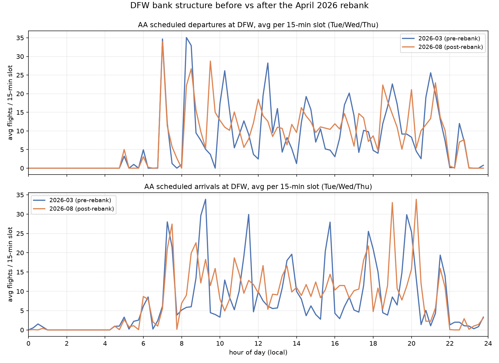
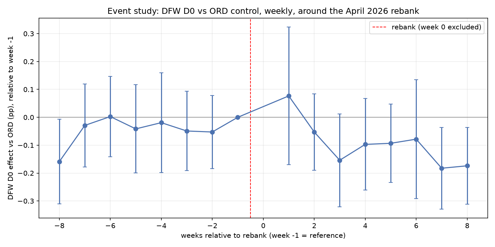
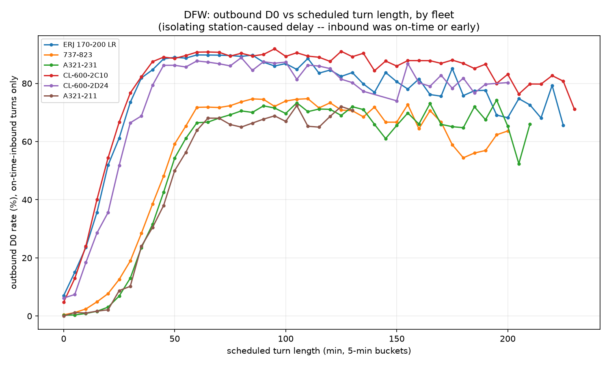

# DFW Hub Performance Analytics

Did American's April 2026 DFW rebank improve departure reliability, net of
weather -- and where are frontline leaders still losing controllable
minutes? An independent, end-to-end analysis on public federal aviation
data (BTS, TSA, CBP, FAA, IEM), built on Microsoft Fabric. DOT and T-100
were scoped out -- see [ADR 0012](docs/decisions/0012-dot-t100-scope-out.md).

Full project plan, data sources, KPI definitions, and the phase-by-phase
build log live in [`planning/project-plan.md`](planning/project-plan.md).

**Status:** Phases 0-3 done. Bronze: all five real sources landed (BTS
44 months/27.8M rows all carriers, TSA 35 weeks, CBP, FAA fleet, IEM
weather). Silver: BTS times resolved to UTC, KPI flags computed, quality
quarantine at 0.017% (target <0.5%). Gold: full star schema live in
`wh_gold` (dims + `fact_flight_leg`, `fact_checkpoint_hour`,
`fact_cbp_wait_hour`, `fact_aircraft_turn`, `fact_station_hour`,
`fact_rebank_effect`), reconciled against bronze raw aggregates to
within 0.0001 point across all 44 months. All four signature analyses
below are done. Phase 5 (Direct Lake semantic model + Power BI report)
is next -- blocked on a licensing step only a human can complete (see
`docs/runbook.md`'s "Not yet built"). See the project plan's "Build
phases" section for the rest.

## Findings

### 1. DFW's bank structure did change around the April 2026 rebank

Reconstructed AA's DFW departure and arrival bank structure directly from
the public schedule (BTS `CRSDepTime`/`CRSArrTime`, Tue/Wed/Thu only, no
internal schedule data) for March 2026 (pre-rebank) vs August 2026
(post-rebank), using `scipy.signal.find_peaks` on scheduled-flight counts
per 15-minute slot -- see `src/hubops/banks.py` and
[`docs/analysis/dim_bank_prototype.csv`](docs/analysis/dim_bank_prototype.csv).



- **Arrival structure fragmented**: 8 clean arrival banks pre-rebank became
  11 narrower, messier ones post-rebank. Departure bank *count* held at 8,
  but banks 2-3 moved earlier (08:15/10:15 -> 08:30/09:30) and morning peak
  heights dropped (e.g. the 08:15 bank fell from ~35 to ~27 avg departures),
  spreading volume across more, smaller waves rather than a few sharp ones.
- **This isn't just a schedule shift, it's schedule volume growth too**:
  total average AA/DFW scheduled departures per weekday rose from 722.6
  (March) to 765.7 (August), +5.9%. Any reliability comparison that doesn't
  control for this (and for weather, the next analysis's job) would
  wrongly blame the rebank for what's partly just more traffic.
- This is the input to signature analysis #2 below -- the bank windows
  here define the treatment-period schedule structure that analysis tests
  reliability against.

### 2. The rebank is associated with a real D0/A14 decline at DFW, net of weather

Weather-adjusted difference-in-differences: treated = AA departures from
DFW, control = AA departures from ORD (an AA hub with no April 2026
structural change), Jan-Aug 2026, clustered by day. Covariates: origin
weather severity (`hubops.metar`), scheduled departures in that hour, month
and hour fixed effects. See
[`analysis/dfw_rebank_diffindiff.py`](analysis/dfw_rebank_diffindiff.py) and
[`docs/analysis/fact_rebank_effect_prototype.csv`](docs/analysis/fact_rebank_effect_prototype.csv).

The rebank week itself wasn't assumed -- it's detected from the schedule:
each week's DFW departure-time histogram is correlated against August's
canonical post-rebank shape, and the first jump that stays sustained for
every remaining week identifies the changeover. That lands on **2026-W15
(April 6-12)**, a much larger and more durable break (+0.21 correlation,
sustained above 0.80 for all 21 remaining weeks) than a smaller, separate
schedule tweak the same method flags around week 8 -- which fades back out
by week 11 and isn't the rebank.

| Metric | DFW effect vs ORD (post - pre) | 95% CI | p-value |
| --- | --- | --- | --- |
| D0 | -6.4 pts | [-10.2, -2.6] | 0.0009 |
| A14 | -8.1 pts | [-12.9, -3.3] | 0.0010 |
| TXO | -0.14 min | [-1.82, 1.53] | 0.87 (null) |

- **D0 and A14 both fell at DFW relative to ORD, net of weather and traffic
  volume** -- consistent with the public tracking this project set out to
  test (Cranky Flier, see the pitch above). TXO shows no measurable effect,
  which is itself informative: whatever changed, it's not showing up as
  slower taxi-out.
- **The effect isn't a step function, it grows in**: the event-study plot
  below shows a mostly flat pre-trend (one borderline week, -8, discussed
  below) followed by a gap that widens over the first ~2 months post-rebank
  rather than appearing immediately -- consistent with an operational
  adjustment period, and a more convincing pattern than an instant jump
  would be (an instant jump is easier to explain by a single confounding
  event on one specific day).



- **Honest caveat on parallel trends**: week -8 (about two months before
  the rebank) shows a marginally significant negative coefficient, the one
  pre-period point whose CI doesn't cross zero. Every other pre-period week
  (-7 through -2) is flat and insignificant. One borderline point in an
  8-week pre-window isn't disqualifying, but it means this result should be
  read as "a real, sizeable, weather-adjusted decline that likely but not
  certainly reflects the rebank" rather than an airtight causal claim --
  exactly why this is a single-control-hub *prototype*, and why the full
  build adds CLT and DFW year-over-year as further controls per the plan.

### 3. Station-caused delay is real and fleet-specific, and turns below a fleet's cliff point are the lever a DFW leader can actually pull

Pulled 893,482 paired DFW turns from `fact_aircraft_turn` (gold), split
by whether the inbound leg was on-time/early or already late, then --
among on-time-inbound turns only, isolating the station's own effect --
bucketed outbound D0 rate by scheduled turn length per fleet. See
[`analysis/dfw_turn_cliff.py`](analysis/dfw_turn_cliff.py) and
[`docs/analysis/turn_cliff_by_fleet.csv`](docs/analysis/turn_cliff_by_fleet.csv).

- **Even with a perfectly on-time inbound, DFW only hits 70.3% outbound
  D0** (400,813/569,760 turns) vs 35.0% when the inbound was already
  late (113,192/323,722) -- a real, large, station-attributable gap
  that has nothing to do with inbound delay.
- **The cliff point is fleet-specific, not one number for the whole
  operation.** The 737-823 (2,023 turns below, 2,697 at/above) shows an
  11.1pp D0 jump right at a 50-minute scheduled turn; A319-132 jumps
  22.5pp at 30 minutes; CL-600-2C11 (CRJ) jumps 7.2pp at 60 minutes on
  thinner volume. Scheduling a 50-minute turn for a 737-823 and a
  50-minute turn for a CRJ are not equivalent decisions.



- **Honest caveat**: this isolates station effect by conditioning on
  on-time inbound, not by randomizing turn length -- a fleet scheduled
  mostly short turns for other operational reasons (gate constraints,
  crew legality) could still confound the fleet-specific cliff location.
  Treat the *existence* of a cliff, and its rough fleet-to-fleet
  ordering, as solid; treat the exact minute as a planning input to
  validate against, not a number to schedule off blindly.

### 4. Weather explains some of the daily D0 miss, but far from most of it -- and the worst days usually aren't the stormy ones

Day-level weighted OLS: D0 rate ~ weather severity (0-4, daily max) +
log(scheduled volume) + station and month fixed effects, across 8,028
station-days (6 AA hubs, Jan 2023-Aug 2026, 99.9% weather coverage). See
[`analysis/dfw_weather_scorecard.py`](analysis/dfw_weather_scorecard.py)
and [`docs/analysis/station_day_scorecard.csv`](docs/analysis/station_day_scorecard.csv).

| Term | Coefficient | p-value |
| --- | --- | --- |
| Weather severity (per point, 0-4) | -6.4 pp D0 | <0.0001 |
| log(scheduled volume) | -30.7 pp D0 | <0.0001 |
| Model fit | R² = 0.422 | F=116.5, p<0.0001 |

- **Weather matters, but volume matters roughly 5x more per unit of
  model contribution** -- congestion (more scheduled departures competing
  for the same gates/ramp/ATC slots) is a bigger systematic drag on D0
  than weather severity in this data.
- **"Leaders are not graded on thunderstorms" cuts both ways**: the 10
  worst station-days vs. expected (controlling for weather and volume)
  are mostly *not* severe-weather days -- ORD 2024-01-15/16 and PHL
  2026-01-27 all show `max_severity_score = 0`, meaning D0 cratered to
  6-18% on clear days with nothing in the model to explain it. That's
  the actionable signal: a bad day with no weather excuse is exactly the
  kind of day worth a real root-cause look, not a shrug.
- **Honest caveat**: `max_severity_score` is each day's single worst
  hourly observation, not a volume-weighted daily severity -- a station
  with one bad hour and otherwise-clear skies scores identically to one
  with sustained all-day weather. A production version would weight by
  how many scheduled departures fell in each severity bucket that day,
  not just take the day's max.

## Architecture

_(diagram + notes land in phase 8)_

## Running locally

```
uv sync
uv run pytest
```

Pure-Python wrangling logic (`src/hubops/`) runs and tests with no Fabric or
network dependency. Fabric items (`fabric/`) sync via this workspace's Git
integration.

## Limits

See "Interview story and honest limits" in the project plan -- BTS delay
causes only exist for 15+ minute-late arrivals, BTS times are gate-out not
door-close, TSA/CBP data describes the airport not AA's customers
specifically, and the rebank test is observational (confounded by weather
and parallel ATC changes), which is why the event-study pre-trend check
exists.
